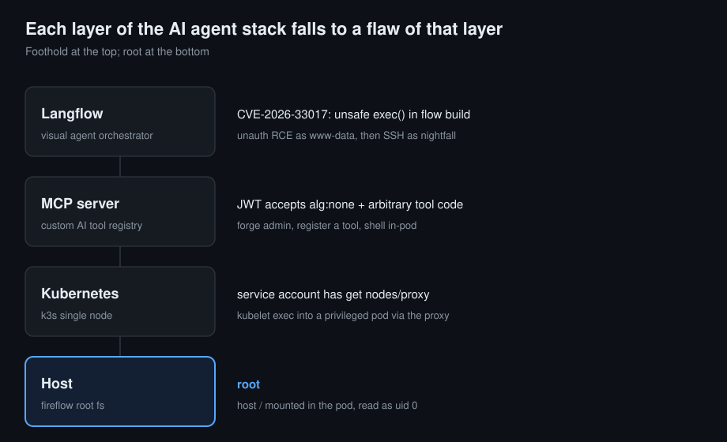

# Fireflow — Attacking the AI Agent Stack


A root-cause-first walk through a modern **AI agent stack**: a visual agent orchestrator (Langflow), a custom **MCP** (Model Context Protocol) tool server, and the Kubernetes cluster underneath. Each layer falls to a flaw characteristic of *that* layer — unsafe dynamic code execution in the orchestrator, a broken JWT check and an arbitrary-tool-registration primitive in the MCP server, and an over-broad service-account permission in the cluster.

This write-up favours **root cause over recipe**, and reads each stage through a security-engineering lens. Secrets, the flow ID, and flags are left as `‹placeholders›` on purpose — the goal is to teach the method, not hand over answers.



Read top to bottom: a leaked flow identifier turns an orchestrator feature into unauthenticated code execution; a reused secret moves us to a real user; a trusting JWT check and an open tool-registration endpoint hand us code execution inside a pod; and a single over-broad Kubernetes permission turns that pod into root on the host. The through-line is an AI-security one: the components that make agents useful — dynamic tool code, flexible orchestration, machine-to-machine trust — are exactly the parts that, built carelessly, become the attack surface.

## The chain at a glance

| # | Layer | Flaw | Technique | Result |
|---|-------|------|-----------|--------|
| 1 | Langflow | CVE-2026-33017 — `exec()` in public flow build | unauth RCE, output read inline (no shell) | `www-data` |
| 2 | Host user | password reused from the orchestrator's `.env` | SSH as `nightfall` | user flag |
| 3 | MCP server | JWT accepts `alg:none`; tool `code` runs server-side | forge admin, register a malicious tool | shell as `mcp` in-pod |
| 4 | Kubernetes | service account has `get nodes/proxy` | kubelet WebSocket exec into a privileged pod | — |
| 5 | Host | privileged pod mounts host `/` | read the host filesystem as uid 0 | **root** |

---

## Table of contents

- [The chain at a glance](#the-chain-at-a-glance)
- [Recon](#recon)
- [Foothold — CVE-2026-33017, from the patch rather than a PoC](#foothold--cve-2026-33017-from-the-patch-rather-than-a-poc)
- [Sidebar: finding a read channel under lockdown](#sidebar-finding-a-read-channel-under-lockdown)
- [Lateral movement — a reused secret](#lateral-movement--a-reused-secret)
- [The MCP server — enumerate the protocol before attacking](#the-mcp-server--enumerate-the-protocol-before-attacking)
- [Forging admin — the JWT `alg:none` matrix](#forging-admin--the-jwt-algnone-matrix)
- [Malicious tool registration — code execution in the pod](#malicious-tool-registration--code-execution-in-the-pod)
- [From a pod to root — `get nodes/proxy`](#from-a-pod-to-root--get-nodesproxy)
- [Blue-team appendix](#blue-team-appendix)
- [Skills demonstrated](#skills-demonstrated)
- [Scripts](#scripts)
- [Sources](#sources)

---

## Recon

Only SSH and HTTPS are open, and the web side routes by `Host` header behind a wildcard certificate — the first hint that the interesting application is not on the default vhost.

```bash
nmap -p- --min-rate 3000 -oN fireflow-allports.txt <target>
nmap -sCV -p22,443 -oN fireflow-svc.txt <target>
```

The certificate is the tell: `CN=fireflow.htb`, `O=Task Force Nightfall`, and a SAN of `*.fireflow.htb`. A wildcard SAN plus a redirect to the hostname means host-based routing, so a different `Host` header can reach a completely different backend that directory fuzzing on the default vhost would never find. (The organization name, *Task Force Nightfall*, also quietly previews the user we will pivot to.)

After adding `fireflow.htb` to `/etc/hosts`, take a baseline for an unknown vhost and fuzz against it:

```bash
curl -sk -o /dev/null -w "%{http_code} %{size_download}\n" -H "Host: x.fireflow.htb" https://<target>/
# 301 162   <- nginx stock redirect body

ffuf -u https://<target>/ -H "Host: FUZZ.fireflow.htb" \
  -w /usr/share/seclists/Discovery/DNS/subdomains-top1million-20000.txt -fs 162
```

That returns one vhost, `flow.fireflow.htb`, a Langflow instance. The leaked flow identifier the foothold needs is sitting in the main site's HTML, in a `/playground/<uuid>` link:

```
https://flow.fireflow.htb/playground/‹FLOW_ID›
```

One recon detail is worth holding onto for the end. The full port scan reports thousands of *filtered* ports (dropped, no response) rather than *closed* (RST). A firewall is silently dropping traffic — consistent with a Kubernetes node whose API server and kubelet are reachable internally but blocked from outside. That is exactly why, much later, the cluster attack has to run from inside the environment rather than from the attacker's box.

---

## Foothold — CVE-2026-33017, from the patch rather than a PoC

Langflow is an open-source visual builder for LLM agents and workflows. CVE-2026-33017 is an unauthenticated remote code execution flaw in its public flow-build endpoint, disclosed in March 2026 and added to CISA's Known Exploited Vulnerabilities catalogue; it is the **second** `exec()`-class unauthenticated RCE in Langflow after CVE-2025-3248, which makes the pattern worth understanding rather than just firing a script at.

### The vulnerability, read from the advisory and the source

The endpoint `POST /api/v1/build_public_tmp/{flow_id}/flow` is intentionally unauthenticated so that *public* flows can be built. The bug is that the vulnerable versions also accept an optional `data` parameter and build *that* attacker-supplied flow instead of the stored one. A flow is a graph of nodes, and a node can carry a `code` field. That code reaches Langflow's dynamic execution path during the build:

```
build_public_tmp  ->  start_flow_build  ->  build_graph_from_data
  ->  Graph.from_payload  ->  instantiate component
  ->  create_class  ->  prepare_global_scope  ->  exec()
```

The detail that makes it a clean, no-interaction primitive: `prepare_global_scope` executes the module's top-level definitions as it sets up the component, so our code runs *during graph build*, before the flow is ever "run." This chain is laid out in the GitHub Security Advisory and confirmed by reading the tagged source.

### The version banner lies — verify the sink, don't trust the label

`GET /api/v1/version` reports `1.8.2`. Reading the upstream history, the fix (commit `73b6612e`, which removes the `data` parameter and hard-codes `data=None`) landed **before** the 1.8.2 tag, so a genuine 1.8.2 should be patched. The box, however, runs pre-patch code behind a 1.8.2 banner. Rather than trust either the banner or the advisory's version range, confirm the sink behaviourally with a cheap oracle:

```bash
curl -sk -X POST "https://flow.fireflow.htb/api/v1/build_public_tmp/‹FLOW_ID›/flow" \
  -H 'Content-Type: application/json' -b 'client_id=x' \
  -d '{"data":"not-an-object"}'
# 422  body.data: "Input should be a valid dictionary or object"
```

The patched build has no `data` field and would silently ignore it (returning a job id); only the vulnerable code *declares and validates* `data`, so a 422 complaining about `body.data` proves the parameter exists and the sink is live. **This 422-vs-200 check is the single most useful step of the whole foothold** — and the lesson generalises: a version string is not proof of patch level.

### Executing code, and reading the output without a shell

The payload is a single node whose `code` defines a trivial class with a `Component`-named base (the loader scans for one before running anything) and does its work in the class body (the executor only runs *definition* statements, so a bare `raise` outside a class is dropped). The build streams its events back inline when asked, so we read command output straight off the response with `?event_delivery=direct` — no reverse shell, which matters because **outbound from this host is firewalled**.

```bash
python3 scripts/fireflow_rce.py "id; hostname"
# uid=33(www-data) gid=33(www-data) ... / fireflow
python3 scripts/fireflow_rce.py "env | sort"
```

The environment dump hands over everything needed to move on:

```
LANGFLOW_SUPERUSER=‹superuser name›
LANGFLOW_SUPERUSER_PASSWORD=‹a leetspeak passphrase themed on the box · ~22 chars›
LANGFLOW_SECRET_KEY=‹a 43-char base64url Fernet key›
```

From an AI-security standpoint, this is the Langflow blast radius in miniature: compromise the orchestrator and you inherit **every secret it holds** — provider keys, signing keys, database credentials — because an agent platform exists precisely to broker access to all of them.

---

## Sidebar: finding a read channel under lockdown

The single line above — "read command output with `?event_delivery=direct`" — hides the real work of this stage, and it is worth a short detour because the reasoning is more reusable than the answer. Getting code to *run* was easy; getting its output *back* was not, because every obvious channel was closed:

- **No outbound.** The first instinct, a reverse shell or an HTTP callback, produced a clean job id and total silence. Egress from the host is firewalled, so nothing that calls home works.
- **The file-to-web trick fails silently.** Writing output into the web root and fetching it looks promising until you notice the frontend is a single-page app with a catch-all route: *any* unknown path returns the same `index.html`, so a "successful" fetch is just the app shell. A missing file never 404s, which turns every read into a false positive.
- **The natural result API needs auth.** The build's own events endpoint (`/api/v1/build/{job_id}/events`) is the intended way to read a build, but it requires authentication and returns 403, even though the build itself was triggered unauthenticated.

The way through was to stop looking for a side channel and re-read the vulnerable endpoint: `build_public_tmp` takes an `event_delivery` parameter, and `?event_delivery=direct` streams the build events inline on the same unauthenticated request. The code's own output surfaces as an event, over the one port we know works.

Two lessons generalise. First, **when exfiltration is hard, the primitive you already have often contains its own channel** — look there before inventing a new one. Second, **confirm a read channel actually reflects your data before trusting it**; a catch-all route or a cached response will happily report success forever.

---

## Lateral movement — a reused secret

`/etc/passwd` shows a real user, `nightfall`, and the Langflow superuser password turns out to be reused for that account's SSH login:

```bash
ssh nightfall@fireflow.htb    # reuse LANGFLOW_SUPERUSER_PASSWORD from the env dump
```

That yields the user flag and a stable shell. The lesson is the oldest one in the book, sharpened by context: a secret pulled from an AI platform's configuration is **not scoped to that platform**. Treat orchestrator secrets as credentials to the whole environment, because password reuse makes them exactly that.

---

## The MCP server — enumerate the protocol before attacking

In nightfall's home, `~/.mcp/config.json` describes how to reach a custom MCP server:

```json
{
  "server": "http://<target>:30080",
  "status_endpoint": "/api/v1/version",
  "user": "‹service-account name · the orchestrator's bot›",
  "password": "‹leetspeak password · brand + @ + mcp + year + !›"
}
```

The Model Context Protocol is how LLM agents connect to external tools and data, so a "custom MCP server" is a piece of **AI infrastructure**, not just another web API — and it deserves to be read as a protocol, not poked at blindly. Port `30080` is also informative: it falls in the Kubernetes NodePort range (30000–32767), so the server runs as a pod exposed through the cluster.

The server is unusually forthcoming. Its version endpoint documents its own attack surface:

```bash
curl -s http://<target>:30080/api/v1/version
```
```json
{"service":"MCP AI Tool Registry",
 "auth":{"type":"JWT","supported_algorithms":["HS256","none"]},
 "endpoints":["POST /mcp","POST /api/v1/auth","GET /api/v1/tools","POST /api/v1/tools [admin]"]}
```

Two things jump out before touching anything: `none` is listed as a *supported* JWT algorithm (the vulnerability, stated by the server itself), and tool registration is admin-gated. Because this is a FastAPI app, `/openapi.json` hands over every request schema for free, including the one that matters — `ToolRegisterRequest` has a `code` field, so **registering a tool submits code the server will run**.

Before attacking, speak the protocol the way a legitimate MCP client would, which both confirms the transport and documents the intended behaviour:

```bash
# JSON-RPC 2.0 over POST /mcp
curl -s -X POST .../mcp -d '{"jsonrpc":"2.0","id":1,"method":"initialize", ...}'
curl -s -X POST .../mcp -d '{"jsonrpc":"2.0","id":2,"method":"tools/list"}'
```

`tools/list` returns three host-command wrappers (`ping_host`, `get_metrics_summary`, `list_running_tasks`), which tells us registered tool code runs system commands. Enumerating at the protocol level first means that when we do attack, we already know the auth model, the transport, the tool-execution convention, and the exact admin claim to forge.

---

## Forging admin — the JWT `alg:none` matrix

Authenticating legitimately with those credentials returns the token to copy as a blueprint:

```
header:  {"alg":"HS256","typ":"JWT"}
payload: {"sub":"‹bot username›","role":"user"}
```

So the admin gate is the `role` claim, there is no `exp`, and the server advertises `none` as acceptable. The classic `alg:none` attack is to set the algorithm to `none` and drop the signature, but "none" has many spellings and signatures have several empty forms, and libraries disagree on which they treat as unsigned. Rather than guess, test the **matrix** against the admin-only `POST /api/v1/tools` with a harmless no-op tool, so nothing executes until we know which token is accepted:

| Variant | Result | What it tells us |
| --- | --- | --- |
| `alg:none`, empty sig (`h.p.`), `role:admin` | `200 registered` | the live forge |
| `alg:None` / `NONE` / `nOnE` | `401 Unsupported algorithm` | the allow-list is a case-sensitive match on literal `none`, not a reject-unsigned rule |
| no trailing dot (`h.p`) | `401 Error decoding token headers` | the parser demands three segments; two are not parsed |
| `role:administrator` / `superuser` | `403 Admin role required` | authentication and authorization are separate; the role must equal `admin` exactly |
| HS256 signed with `LANGFLOW_SECRET_KEY` | `401 Signature verification failed` | the MCP server does not reuse Langflow's signing key |

Exactly one forge works: lowercase `alg:none`, a three-segment token with an **empty** signature, and `role` set to `admin`. Build it yourself rather than copying a blob:

```
base64url({"alg":"none","typ":"JWT"}) . base64url({"sub":"‹bot›","role":"admin"}) .
# note the trailing dot and the empty third segment
```

The root cause is visible in the error strings. A correct implementation never lists `none` among accepted algorithms and rejects unsigned tokens outright; here the verifier accepts `none` because it is in an allow-list, and the case-sensitivity betrays a naive membership test rather than normalise-then-reject. The HS256 control is worth keeping even though it failed — secret reuse across services was a reasonable hypothesis, and ruling it out is a finding, not a dead end. The broader AI-security point: **machine-to-machine trust between agent components rides on tokens like this**, and a single over-permissive `verify` turns "authenticated service account" into "anyone."

---

## Malicious tool registration — code execution in the pod

With the forged admin token, `POST /api/v1/tools` accepts a tool whose `code` field the server executes. The calling convention is worth nailing down empirically rather than assuming: register a probe that *returns* a value and you get an empty result; register one that `print()`s and the output comes back. The server captures **stdout**, which also fits the existing tools ("return ICMP output," "list processes"). Invoke a registered tool over the MCP endpoint with `tools/call`, and read the result from `result.content[0].text`.

A stdout probe establishes where we are:

```
uid=1000(mcp)
hostname mcp-server-<hash>
/var/run/secrets/kubernetes.io/serviceaccount/{token,ca.crt,namespace}
```

That is a Kubernetes pod carrying a **service-account token** — the launch point for the cluster. We now have arbitrary code execution inside the MCP pod, reached entirely through the server's own tool-registration feature.

### The AI-security angle: registration is a dual primitive

Direct code execution is the obvious outcome, but it undersells the problem. An MCP tool registry is consumed by **agents**: a model calls `tools/list`, reads each tool's name and description, and decides what to invoke. So a writable tool registry is also a **tool-poisoning** primitive. A malicious tool need not even be called to do harm — its *description* is fed into the context of every agent that lists the tools, which makes the description a **prompt-injection vector**: it can instruct a downstream model to exfiltrate data, call another tool with attacker-chosen arguments, or mislabel a dangerous action as safe.

On this box no agent consumes the registry — we drive it directly — so poisoning stays impact analysis rather than a live demonstration. But it is the more important lesson for defenders: an authorization bug on a tool-registration endpoint is not only an RCE, it is a **supply-chain foothold** into any agent that trusts the registry. The controls that follow from that framing — signing tool definitions, treating tool descriptions as untrusted input, human review before a tool becomes callable — are exactly the ones a plain "RCE via `code` field" reading would miss.

---

## From a pod to root — `get nodes/proxy`

The pod's service account, `system:serviceaccount:default:mcp-sa`, has a deliberately narrow grant. A `SelfSubjectRulesReview` confirms it:

```
verbs=[get]  resources=[nodes/proxy]
(plus only the self-review verbs)
```

One useful rule: `get` on the `nodes/proxy` subresource. No `get nodes`, no `create nodes/proxy`, no pods, no secrets. This looks read-only, and that appearance is the whole trick.

### Why read-only reaches code execution

The API server proxies requests to the kubelet on the node, and the kubelet exposes an exec endpoint. The catch that pins everything down: **through the proxy, the HTTP method maps to an RBAC verb.** A `POST` is authorized as `create nodes/proxy` (which we lack, and which returns a clear 403), while a `GET` is authorized as `get nodes/proxy` (which we have). Kubelet exec runs over a WebSocket, and a WebSocket handshake *is* an HTTP GET with an `Upgrade` header — so it passes the `get` check, and **no second authorization for the exec itself is performed.**

Enumerating the kubelet's `/pods` (a GET, so allowed) reveals the target: the monitoring stack's `node-exporter` pod runs **privileged**, as `runAsUser: 0`, with `hostPID`, and mounts the host's entire `/` filesystem. Exec a command there and you are root on the host with its disk mounted.

### Getting the exec request right — from the source, not a blog

The exec handshake is finicky, and this is where reading the Kubernetes source beats any write-up. Every attempt returned `400: you must specify at least 1 of stdin, stdout, stderr`, even while sending `stdout=true`. The cause is in the kubelet's own stream-option parser, which reads the parameters like this:

```go
// cri-streaming .../remotecommand/httpstream.go (NewOptions)
stdout := req.FormValue(ExecStdoutParam) == "1"
// constants.go:
ExecStdinParam = "input"; ExecStdoutParam = "output"; ExecStderrParam = "error"
```

Two mismatches at once: the parameters are named `input`/`output`/`error`, **not** `stdin`/`stdout`/`stderr`, and the value must be the string `"1"`, **not** `"true"`. With `output=1&error=1` the request is accepted. The working client is a WebSocket connection with subprotocol `v4.channel.k8s.io`; the kubelet multiplexes streams by prefixing each binary message with a channel byte (`0` stdin, `1` stdout, `2` stderr), so command output is read off channel 1.

```python
url = f"wss://{NODE}:10250/exec/{NS}/{POD}/node-exporter?output=1&error=1&{args}"
# subprotocols=["v4.channel.k8s.io"], Authorization: Bearer <sa-token>
# read frames; channel byte 1 == stdout
```

The mount table confirms the setup — the host disk is mounted read-only at `/host/root` inside the container (so the host's `/root/root.txt` is `/host/root/root/root.txt`), and the k3s paths show a single-node cluster running on the host itself:

```
uid=0(root) gid=65534(nobody) groups=10(wheel),65534(nobody)
/dev/sda2 /host/root ext4 ro ...
root.txt: ‹the 32-hex root flag›
```

That is **root on `fireflow`**, reached from a "read-only" Kubernetes permission.

---

## Blue-team appendix

Each stage leaves a signal and has a one-line fix. The theme: every link in this chain is a default or a convenience left too open, not an exotic bug.

| Stage | What it leaves in the logs | The fix |
| --- | --- | --- |
| Langflow RCE | Unauth `POST /build_public_tmp/*/flow` with a `data` body; a child process spawned by the Langflow service | Patch to ≥ 1.9.0; keep Langflow off the public internet and behind auth; don't trust the version banner — verify |
| Secret exposure | n/a (read in-process) | Scope orchestrator secrets to the orchestrator; never reuse a service password for a login account; rotate on exposure |
| SSH as nightfall | `sshd` accepted-password event for nightfall | Unique credentials per account; key-only SSH |
| MCP JWT forge | `POST /api/v1/auth` then admin calls with no prior privileged auth; tokens with `alg:none` | Never accept `none`; pin the algorithm server-side; validate signatures with a vetted library |
| Tool registration | `POST /api/v1/tools` creating a tool, then `tools/call`; a new child process in the MCP pod | Don't execute user-supplied tool code; if you must, sandbox it; sign tool definitions and review before they're callable |
| `nodes/proxy` exec | kube-audit entries for `get nodes/proxy` on `/exec`; a kubelet exec with **no** matching `pods/exec` audit line | Remove `nodes/proxy` from workload accounts; restrict kubelet :10250 by NetworkPolicy; alert on `nodes/proxy` to `/exec` |

Two detection notes worth emphasising. First, the kubelet-exec step produces **no** `pods/exec` audit entry — the only trace is the `nodes/proxy` SubjectAccessReview and the proxy request itself, so a SOC watching only `pods/exec` is blind to it. Second, the whole chain is quiet on the attacker side because nothing calls outbound; defenders should not expect a beacon.

---

## Skills demonstrated

- **AI/LLM infrastructure security** — attacking an agent orchestrator (Langflow) and a custom MCP tool registry; tool-poisoning and prompt-injection impact analysis.
- **Source-driven exploitation** — building the exploit from the patch diff and the advisory rather than a public PoC; reading Kubernetes and Langflow source to settle behaviour that blog posts get wrong.
- **Vulnerability verification** — the 422-vs-200 oracle to prove a sink is live despite a misleading version banner.
- **Exfiltration under constraints** — turning a blind primitive into a readable one with no egress and no filesystem.
- **JWT attacks** — `alg:none` forgery, tested as a full variant matrix with a root-cause explanation.
- **Kubernetes privilege escalation** — `get nodes/proxy` → kubelet WebSocket exec → host root, with the HTTP-method-to-RBAC-verb nuance.
- **Defensive thinking** — per-stage detection and remediation, including the `pods/exec` audit blind spot.

---

## Scripts

The four scripts in [`scripts/`](scripts/) are the ones that actually carried the chain. Secrets, the flow id, and the node address are left as placeholders — fill them from your own run. They are written to be read, not copy-pasted blind.

| Script | Stage | What it does |
| --- | --- | --- |
| [`fireflow_rce.py`](scripts/fireflow_rce.py) | Foothold | Langflow unauth RCE; reads output inline via `event_delivery=direct` |
| [`mcp_client.py`](scripts/mcp_client.py) | MCP | Forges the `alg:none` admin token; registers and calls tools |
| [`jwt_matrix.py`](scripts/jwt_matrix.py) | JWT | Tests the full `alg:none` / signature / role matrix against the admin endpoint |
| [`kexec_v4.py`](scripts/kexec_v4.py) | Root | Kubelet exec into the privileged pod via `get nodes/proxy` |

See [`scripts/README.md`](scripts/README.md) for usage and the load-bearing details (the class-body trick, the direct-delivery channel, the `output=1` / `v4` kubelet params).

---

## Sources

References consulted while researching this write-up:

- [GitHub Security Advisory GHSA-vwmf-pq79-vjvx — Unauthenticated RCE in Langflow via the public flow-build endpoint](https://github.com/langflow-ai/langflow/security/advisories/GHSA-vwmf-pq79-vjvx)
- [CVE-2026-33017 summary (Rainforest)](https://www.rainforest.tech/en/cves/CVE-2026-33017)
- [Orca Security — Langflow RCE (CVE-2026-33017)](https://orca.security/resources/blog/langflow-rce-vulnerability-cve-2026-33017)
- [Langflow source and the fix commit `73b6612e`](https://github.com/langflow-ai/langflow) — used to confirm the sink and that the fix predates the 1.8.2 tag
- [Langflow build-endpoint API docs](https://docs.langflow.org/api-build)
- [Kubernetes source: cri-streaming remotecommand exec option parser](https://github.com/kubernetes/kubernetes) — the `input`/`output`/`error` == `"1"` parsing
- [zwindler — nodes/proxy GET: one Kubernetes permission too many](https://blog.zwindler.fr/en/2026/05/19/nodes/proxy-get-one-kubernetes-permission-too-many/)
- [Horizon3.ai — When read-only isn't: k8s nodes/proxy GET to RCE](https://horizon3.ai/attack-research/when-read-only-isnt-k8s-nodes-proxy-get-to-rce/)
- [kubeletctl (CyberArk) — kubelet exec/run request construction](https://github.com/cyberark/kubeletctl)
- [Red Hat — Executing commands in pods using the K8s API](https://www.redhat.com/en/blog/executing-commands-in-pods-using-k8s-api)

---

*Written up by **mnfrdgbrl**. This write-up is for education and authorized testing only — see [DISCLAIMER](DISCLAIMER.md).*
